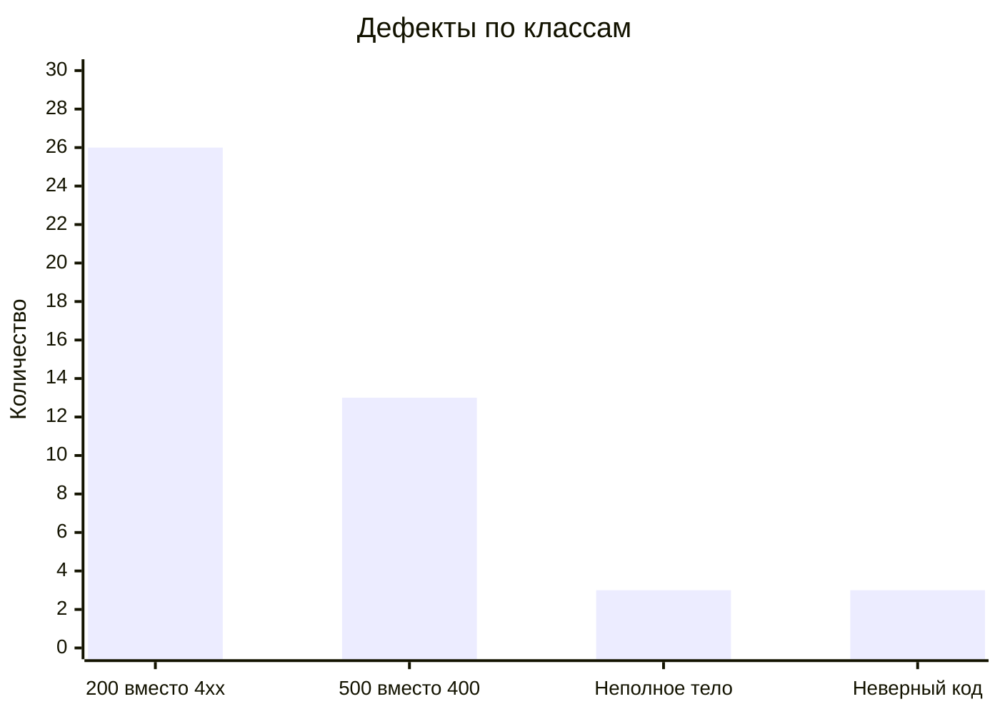
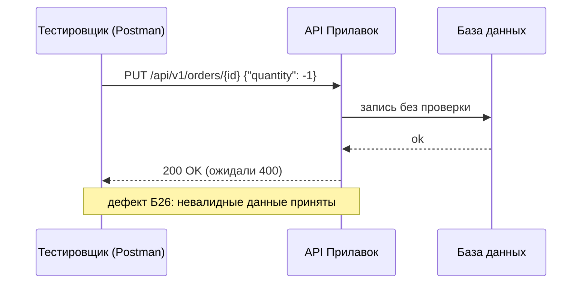

```text
┌──────────────────────────────────────────────────────────────┐
│  POST /api/v1/kits/{id}/products      →  200   ожидали 400  │
│  PUT  /api/v1/orders/{id}             →  500   ожидали 400  │
│  POST /fast-delivery/v3.1.1/…          →  200   неполное тело│
└──────────────────────────────────────────────────────────────┘
```

# Прилавок · тестирование API

     

Проверка REST- и XML-методов бэкенда приложения «Прилавок» (v3.1.1): наборы, корзина и доставка «Привезём быстро». Проект — переход от тестирования интерфейса к тестированию контракта: запрос, код ответа, тело, формат ошибки.

🖥 **[Интерактивная консоль](https://ikqavscode-afk.github.io/Sprint_5/)** · [Реестр дефектов](https://ikqavscode-afk.github.io/Sprint_5/bugs.html) · [Песочница контракта](https://ikqavscode-afk.github.io/Sprint_5/playground.html) · [Чек-лист тестировщика API](https://ikqavscode-afk.github.io/Sprint_5/checklist.html)

## О проекте

| | |
|---|---|
| **Цель** | Проверить поведение методов API на соответствие требованиям и оформить результаты так, чтобы дефекты воспроизводились одной командой. |
| **Ценность** | Сквозная цепочка «требование → проверка → запрос → дефект → запрос в коллекции Postman». Каждый из 45 дефектов привязан к проверке, запросу и классу ошибки. |
| **Польза** | Готовая коллекция Postman для повторных проверок после исправлений; контракт в формате OpenAPI; генератор негативных тестов и песочница-оракул; примеры оформления API-дефектов. |
| **Функции** | Чек-лист из 102 проверок; реестр дефектов с классификацией; анализ кодов ответов; серые зоны требований; интерактивная консоль на GitHub Pages; автогенерация документов и коллекции из данных. |

## Главное наблюдение



- Основной класс ошибок — **отсутствие валидации**: сервер принимает невалидные данные (26 из 45 дефектов).
- **13** запросов приводят к необработанной ошибке 500; в **6** случаях ответ раскрывает технические детали (разбор XML, синтаксис SQL-типа), в **5** — возвращается HTML вместо JSON.

## Как работает проверка



## Структура

| Путь | Что внутри |
|---|---|
| [`test-analysis/`](test-analysis/) | декомпозиция, классы эквивалентности и границы, таблица решений, серые зоны |
| [`test-cases/`](test-cases/) | чек-лист API (фрагмент) |
| [`bug-reports/`](bug-reports/bug-reports.md) | 45 дефектов, 10 подробно, со скриншотами |
| [`reports/`](reports/) | анализ дефектов |
| [`postman/`](postman/) | коллекция Postman и шаблон окружения |
| [`api/openapi-tested.yaml`](api/openapi-tested.yaml) | восстановленный контракт проверенных методов |
| [`regression/`](regression/retest-checklist.md) | ретест после исправлений |
| [`checklist.md`](checklist.md) | чек-лист проекта: паспорт и результаты |
| [`docs/`](docs/) | сайт GitHub Pages |
| [`data/`](data/) | исходные данные в JSON |

## Быстрый старт: коллекция Postman

1. Импортируйте `postman/prilavok-api-regression.postman_collection.json` и `postman/environment.template.json`.
2. В окружении заполните `baseUrl` и `token`.
3. Запустите папку **«00 Подготовка»**, затем остальные папки через Collection Runner.
4. До исправления запросы показывают дефекты; после — все проверки должны проходить.

## Эволюция подходов (серия проектов)

| Проект | Объект | Фокус |
|---|---|---|
| Ручное тестирование интерфейса | веб-приложение | кейсы, баги, ретест |
| Тест-дизайн | форма с расчётом | классы эквивалентности, границы |
| Вёрстка и логика | форма бронирования | чек-листы, кроссбраузерность |
| Мобильная регрессия | приложение Android | регрессия, решение о релизе |
| **API (этот проект)** | **REST и XML методы** | **контракт, коды ответов, воспроизводимые запросы** |

Предыдущие работы: [qa-test-documentation](https://github.com/ikqavscode-afk/qa-test-documentation).
