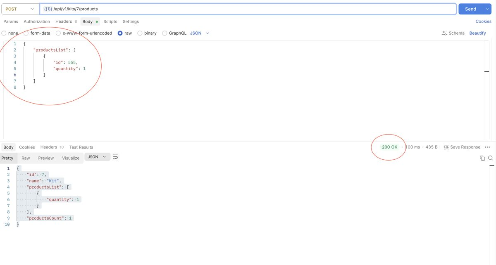
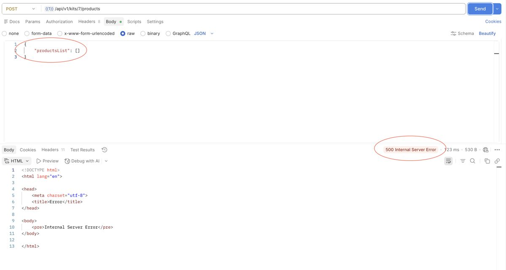
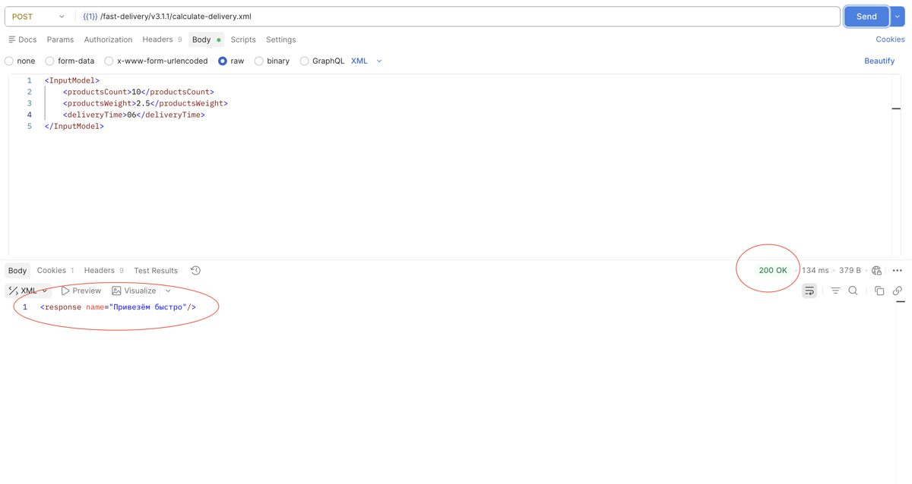
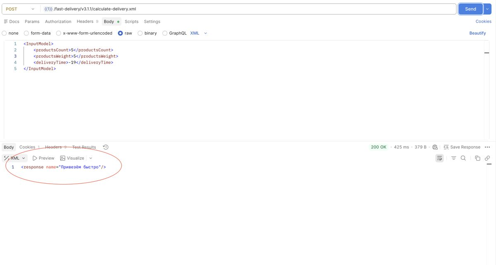
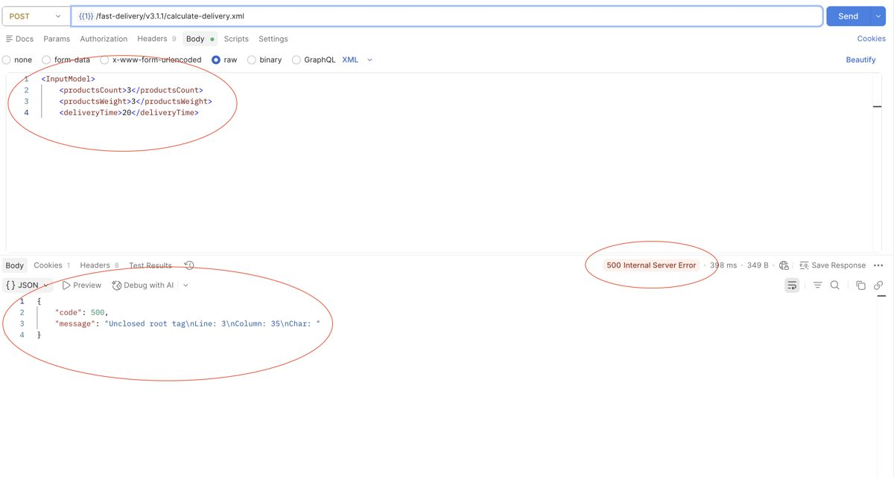
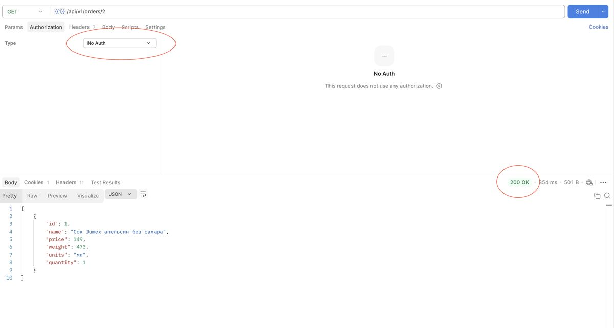
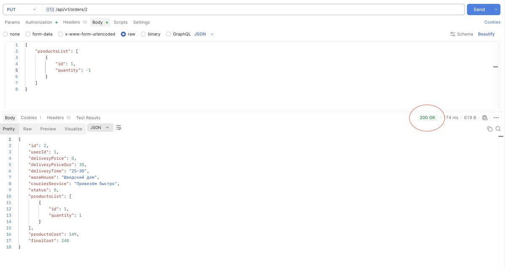
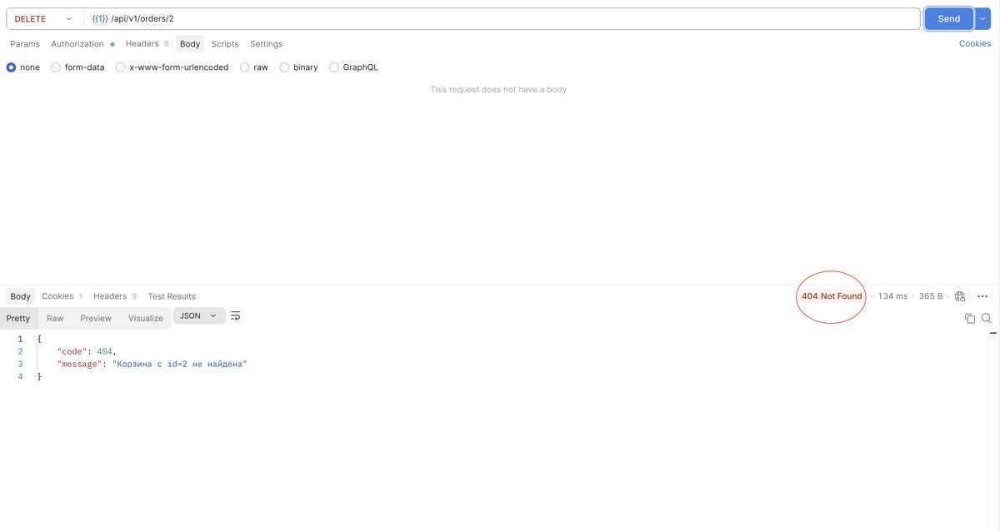
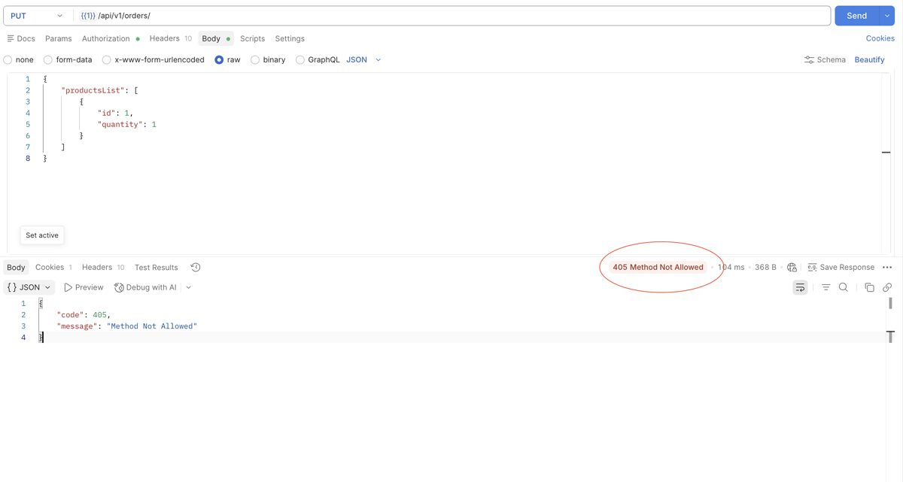
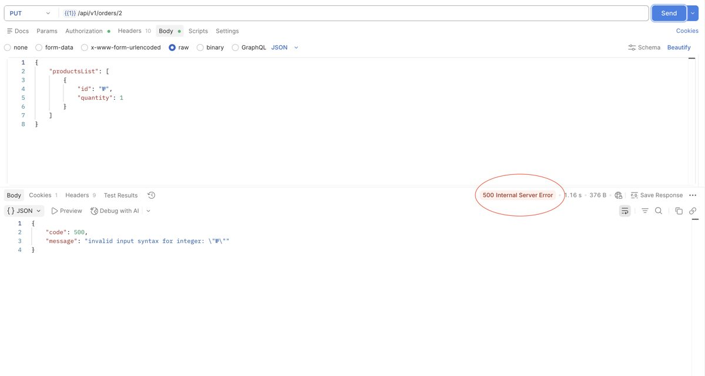

# Дефекты API (демо-версия)

Всего **45** дефектов, все открыты. Ниже таблица всех и 10 подробных. Реестр с фильтрами: https://ikqavscode-afk.github.io/Sprint_5/bugs.html

| ID | Метод | Путь | Ожидали → получили | Класс | Серьёзность |
|---|---|---|---|---|---|
| Б1 | POST | `/api/v1/kits/id/products` | 400 → 200 | Нет валидации | Medium |
| Б2 | POST | `/api/v1/kits/id/products` | 400 → 200 | Нет валидации | Medium |
| Б3 | POST | `/api/v1/kits/id/products` | 400 → 200 | Нет валидации | Medium |
| Б4 | POST | `/api/v1/kits/id/products` | 400 → 200 | Нет валидации | Medium |
| Б5 | POST | `/api/v1/kits/id/products` | 400 → 500 | Необработанная ошибка | High |
| Б6 | POST | `/api/v1/kits/id/products` | 400 → 500 | Необработанная ошибка | High |
| Б7 | POST | `/api/v1/kits/id/products` | 400 → 500 | Необработанная ошибка | High |
| Б8 | POST | `/fast-delivery/v3.1.1/calculate-delivery.xml` | 200 → 200 | Неполное тело ответа | Medium |
| Б9 | POST | `/fast-delivery/v3.1.1/calculate-delivery.xml` | 200 → 200 | Неполное тело ответа | Medium |
| Б10 | POST | `/fast-delivery/v3.1.1/calculate-delivery.xml` | 400 → 200 | Нет валидации | Medium |
| Б11 | POST | `/fast-delivery/v3.1.1/calculate-delivery.xml` | 400 → 200 | Нет валидации | Medium |
| Б12 | POST | `/fast-delivery/v3.1.1/calculate-delivery.xml` | 400 → 200 | Нет валидации | Medium |
| Б13 | POST | `/fast-delivery/v3.1.1/calculate-delivery.xml` | 400 → 200 | Нет валидации | Medium |
| Б14 | POST | `/fast-delivery/v3.1.1/calculate-delivery.xml` | 400 → 500 | Необработанная ошибка | High |
| Б15 | POST | `/fast-delivery/v3.1.1/calculate-delivery.xml` | 400 → 500 | Необработанная ошибка | High |
| Б16 | POST | `/fast-delivery/v3.1.1/calculate-delivery.xml` | 400 → 500 | Необработанная ошибка | High |
| Б17 | POST | `/fast-delivery/v3.1.1/calculate-delivery.xml` | 400 → 200 | Нет валидации | Medium |
| Б18 | POST | `/fast-delivery/v3.1.1/calculate-delivery.xml` | 400 → 200 | Нет валидации | Medium |
| Б19 | POST | `/fast-delivery/v3.1.1/calculate-delivery.xml` | 400 → 200 | Нет валидации | Medium |
| Б20 | POST | `/fast-delivery/v3.1.1/calculate-delivery.xml` | 400 → 200 | Нет валидации | Medium |
| Б21 | POST | `/fast-delivery/v3.1.1/calculate-delivery.xml` | 400 → 500 | Необработанная ошибка | High |
| Б22 | POST | `/fast-delivery/v3.1.1/calculate-delivery.xml` | 400 → 200 | Неверный код ответа | Low |
| Б23 | GET | `/api/v1/orders/id` | 401 → 200 | Нет валидации | High |
| Б26 | PUT | `/api/v1/orders/id` | 400 → 200 | Нет валидации | High |
| Б27 | PUT | `/api/v1/orders/id` | 400 → 200 | Нет валидации | High |
| Б28 | PUT | `/api/v1/orders/id` | 400 → 200 | Нет валидации | Medium |
| Б29 | DELETE | `/api/v1/orders/id` | 200 → 404 | Неверный код ответа | Low |
| Б1-1 | POST | `/api/v1/kits/id/products` | 400 → 200 | Нет валидации | Medium |
| Б1-2 | POST | `/api/v1/kits/id/products` | 400 → 500 | Необработанная ошибка | High |
| Б1-3 | POST | `/api/v1/kits/id/products` | 400 → 200 | Нет валидации | Medium |
| Б1-4 | POST | `/api/v1/kits/id/products` | 400 → 200 | Нет валидации | Medium |
| Б1-5 | POST | `/api/v1/kits/id/products` | 400 → 500 | Необработанная ошибка | High |
| Б1-6 | POST | `/fast-delivery/v3.1.1/calculate-delivery.xml` | 200 → 200 | Неполное тело ответа | Medium |
| Б1-7 | POST | `/fast-delivery/v3.1.1/calculate-delivery.xml` | 400 → 200 | Нет валидации | Medium |
| Б1-8 | POST | `/fast-delivery/v3.1.1/calculate-delivery.xml` | 400 → 200 | Нет валидации | Medium |
| Б1-9 | PUT | `/api/v1/orders/id` | 400 → 200 | Нет валидации | Medium |
| Б1-10 | PUT | `/api/v1/orders/id` | 404 → 405 | Неверный код ответа | Low |
| Б1-11 | PUT | `/api/v1/orders/id` | 400 → 500 | Необработанная ошибка | High |
| Б1-12 | PUT | `/api/v1/orders/id` | 400 → 200 | Нет валидации | High |
| Б1-13 | PUT | `/api/v1/orders/id` | 400 → 500 | Необработанная ошибка | High |
| Б1-14 | PUT | `/api/v1/orders/id` | 400 → 200 | Нет валидации | High |
| Б1-1-1 | PUT | `/api/v1/orders/id` | 400 → 500 | Необработанная ошибка | High |
| Б1-1-2 | PUT | `/api/v1/orders/id` | 400 → 200 | Нет валидации | Medium |
| Б1-1-3 | PUT | `/api/v1/orders/id` | 400 → 500 | Необработанная ошибка | High |
| Б1-1-4 | PUT | `/api/v1/orders/id` | 400 → 200 | Нет валидации | Medium |

---

## Б1: Продукт с несуществующим id не добавляется в набор

**Запрос:** `POST /api/v1/kits/id/products` · **Ожидали:** 400 · **Получили:** 200 · **Класс:** Нет валидации · **Серьёзность:** Medium

**Тело запроса:**

```json
{
    "productsList": [
        {
            "id": 555,
            "quantity": 1
        }
    ]
}
```

**Ожидаемый результат:**

```text
Код и статус ответа: HTTP/1.1 400 Bad request.
{
       "code": 400,
       "message":  "Не все необходимые параметры были переданы"
}
```

**Фактический результат:**

```text
Код и статус овета:  HTTP/1.1 200 OK
{
    "id": 7,
    "name": "Kit",
    "productsList": [
        {
            "quantity": 1
        }
    ],
    "productsCount": 1
}
```



---

## Б5: Продукт не добавляется в новый пустой набор с параметром productsList пустой массив []

**Запрос:** `POST /api/v1/kits/id/products` · **Ожидали:** 400 · **Получили:** 500 · **Класс:** Необработанная ошибка · **Серьёзность:** High

**Тело запроса:**

```json
{
    "productsList": [
        {
        }
    ]
}
```

**Ожидаемый результат:**

```text
Код и статус ответа: HTTP/1.1 400 Bad request.
{
       "code": 400,
       "message":  "Не все необходимые параметры были переданы"
}
```

**Фактический результат:**

```text
Код и статус овета: HTTP/1.1 500 Internal server erorr
<!DOCTYPE html>
<html lang="en">

<head>
    <meta charset="utf-8">
    <title>Error</title>
</head>

<body>
    <pre>Internal Server Error</pre>
</body>

</html>
```



---

## Б8: Доставка "Привезем быстро" время доставки 06.

**Запрос:** `POST /fast-delivery/v3.1.1/calculate-delivery.xml` · **Ожидали:** 200 · **Получили:** 200 · **Класс:** Неполное тело ответа · **Серьёзность:** Medium

**Тело запроса:**

```xml
<InputModel>
    <productsCount>10</productsCount>
    <productsWeight>4</productsWeight>
    <deliveryTime>06</deliveryTime>
</InputModel>
```

**Ожидаемый результат:**

```text
Код и статус ответа: 200 OK
<response name="Привезём быстро" 
isItPossibleToDeliver="false" 
</response>
```

**Фактический результат:**

```text
Код и статус овета: 200 ОК
<response name="Привезём быстро"/>
```



---

## Б12: Доставка "Привезем быстро" время доставки -19.

**Запрос:** `POST /fast-delivery/v3.1.1/calculate-delivery.xml` · **Ожидали:** 400 · **Получили:** 200 · **Класс:** Нет валидации · **Серьёзность:** Medium

**Тело запроса:**

```xml
<InputModel>
    <productsCount>5</productsCount>
    <productsWeight>2</productsWeight>
    <deliveryTime>-19</deliveryTime>
</InputModel>
```

**Ожидаемый результат:**

```text
Код и статус ответа: 400 Bad request.
```

**Фактический результат:**

```text
Код и статус овета: 200 ОК 
<response name="Привезём быстро" isItPossibleToDeliver="true" hostDeliveryCost="23" clientDeliveryCost="0">
    <toBeDeliveredTime>
        <min>25</min>
        <max>30</max>
    </toBeDeliveredTime>
</response>
```



---

## Б16: Доставка "Привезем быстро", при ошибке в запросе XML.

**Запрос:** `POST /fast-delivery/v3.1.1/calculate-delivery.xml` · **Ожидали:** 400 · **Получили:** 500 · **Класс:** Необработанная ошибка · **Серьёзность:** High

**Тело запроса:**

```xml
<InputModel>
    <productsCount>3</productsCount>
    <productsWeight>3</productsWeight>
    <deliveryTime>20</deliveryTime>
```

**Ожидаемый результат:**

```text
Код и статус ответа: 400 Bad request.
```

**Фактический результат:**

```text
Код и статус овета: 500 Internal Server Error
{
    "code": 500,
    "message": "Unclosed root tag\nLine: 3\nColumn: 35\nChar: "
}
```



---

## Б23: Список с добавленными продуктами не появляется если пользователь неавторизован

**Запрос:** `GET /api/v1/orders/id` · **Ожидали:** 401 · **Получили:** 200 · **Класс:** Нет валидации · **Серьёзность:** High

**Подготовка:** 1. Создать корзину — POST /api/v1/orders; 4. Authorization Type — No Auth

**Тело запроса:**

```json
{
    "productsList": [
        {
            "id": 1,
            "quantity": 1
        }
    ]
}
```

**Ожидаемый результат:**

```text
Код и статус ответа: HTTP/1.1 401 Unauthorized.
{
       "code": 401,
       "message": "Unauthorized",
   }
```

**Фактический результат:**

```text
Код и статус овета: 200 ОК 
[
    {
        "id": 1,
        "name": "Сок Jumex апельсин без сахара",
        "price": 149,
        "weight": 473,
        "units": "мл",
        "quantity": 1
    }
]
```



---

## Б26: Продукты не добавляются в корзину при количестве c отрицательным числом

**Запрос:** `PUT /api/v1/orders/id` · **Ожидали:** 400 · **Получили:** 200 · **Класс:** Нет валидации · **Серьёзность:** High

**Подготовка:** 1. Создать пользователя — POST /api/v1/users; 3. Authorization Type — Bearer token; 4. Создать корзину — POST /api/v1/orders

**Тело запроса:**

```json
{
    "productsList": [
        {
            "id": 1,
            "quantity": -1
        }
    ]
}
```

**Ожидаемый результат:**

```text
Код и статус ответа: HTTP/1.1 400 Bad request.
{
       "code": 400,
       "message": "Не все необходимые параметры были переданы"
   }
```

**Фактический результат:**

```text
Код и статус овета: 200 OK
{
    "id": 2,
    "userId": 1,
    "deliveryPrice": 0,
    "deliveryPriceOur": 30,
    "deliveryTime": "25~30",
    "wareHouse": "Шведский дом",
    "courierService": "Привезём быстро",
    "status": 0,
    "productsList": [
        {
            "id": 1,
            "quantity": 1
        }
    ],
    "productsCost": 149,
    "finalCost": 248
}
```



---

## Б29: Удаление корзины, удаленной ранее (повторный запрос)

**Запрос:** `DELETE /api/v1/orders/id` · **Ожидали:** 200 · **Получили:** 404 · **Класс:** Неверный код ответа · **Серьёзность:** Low

**Подготовка:** 1. Создать пользователя — POST /api/v1/users; 3. Authorization Type — Bearer token; 4. Создать корзину — POST /api/v1/orders

**Тело запроса:**

```json
{
    "productsList": [
        {
            "id": 1,
            "quantity": 1
        }
    ]
}
```

**Ожидаемый результат:**

```text
Код и статус ответа: HTTP/1.1 200 OK
{
       "ok": true
}
```

**Фактический результат:**

```text
Код и статус овета: HTTP/1.1 404 Not Found
{
    "code": 404,
    "message": "Корзина с id=2 не найдена"
}
```



---

## Б1-10: Продукты не добавляются в корзину при отсутствии параметра id корзины

**Запрос:** `PUT /api/v1/orders/id` · **Ожидали:** 404 · **Получили:** 405 · **Класс:** Неверный код ответа · **Серьёзность:** Low

**Подготовка:** 1. Создать пользователя — POST /api/v1/users; 3. Authorization Type — Bearer token; 4. Создать корзину — POST /api/v1/orders

**Тело запроса:**

```json
{
    "productsList": [
        {
            "id": 1,
            "quantity": 1
        }
    ]
}
```

**Ожидаемый результат:**

```text
Код и статус ответа: HTTP/1.1 404 Not Found
```

**Фактический результат:**

```text
Код и статус овета: 405 Method Not Allowed
{
    "code": 405,
    "message": "Method Not Allowed"
}
```



---

## Б1-1-1: Продукты не добавляются в корзину при значении id продукта спецсимвол

**Запрос:** `PUT /api/v1/orders/id` · **Ожидали:** 400 · **Получили:** 500 · **Класс:** Необработанная ошибка · **Серьёзность:** High

**Подготовка:** 1. Создать пользователя — POST /api/v1/users; 3. Authorization Type — Bearer token; 4. Создать корзину — POST /api/v1/orders

**Тело запроса:**

```json
{
    "productsList": [
        {
            "id": "№",
            "quantity": 1
        }
    ]
}
```

**Ожидаемый результат:**

```text
Код и статус ответа: HTTP/1.1 400 Bad request.
{
       "code": 400,
       "message": "Не все необходимые параметры были переданы"
   }
```

**Фактический результат:**

```text
Код и статус овета: 500 Internal Server Error 
{
    "code": 500,
    "message": "invalid input syntax for integer: \"№\""
}
```



---
