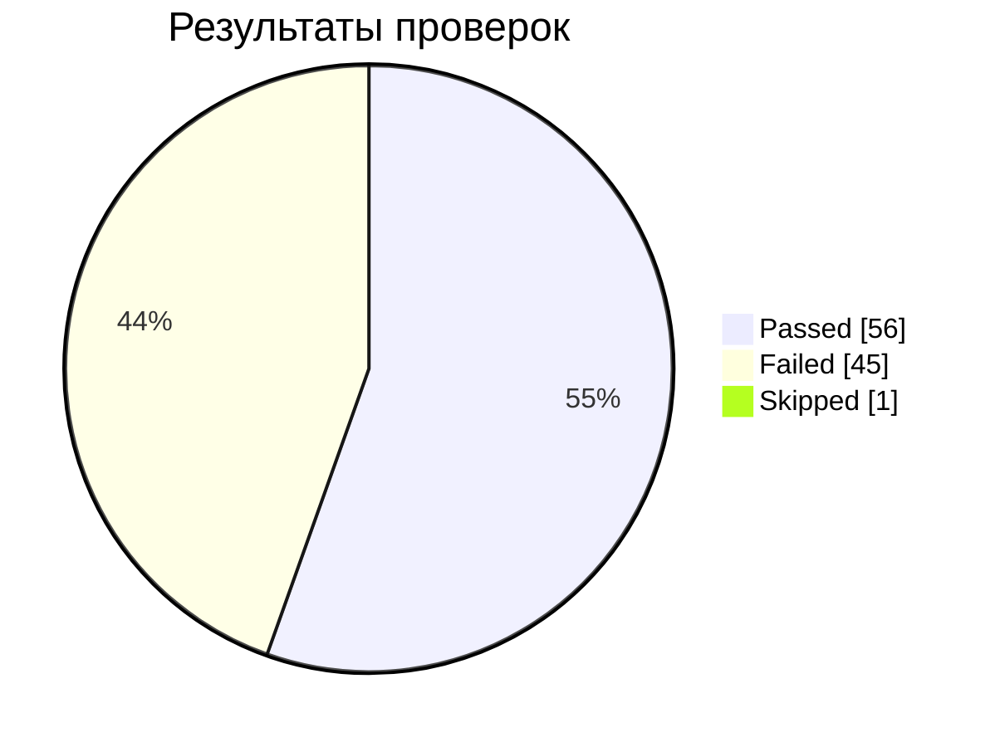

# Анализ дефектов

## Сводка
| Показатель | Значение |
|---|---|
| Проверок | 102 |
| ✅ Passed / ❌ Failed / ⏭ Skipped | 56 / 45 / 1 |
| Pass rate среди выполненных | 55.4% |
| Дефектов | 45 |

## Классы дефектов
| Класс | Кол-во | Доля |
|---|---|---|
| Нет валидации: сервер принял невалидный запрос (200 вместо 4xx) | 26 | 58% |
| Необработанная ошибка: 500 вместо 400 | 13 | 29% |
| Неполное тело ответа | 3 | 7% |
| Неверный код ответа | 3 | 7% |

## Где сосредоточены дефекты
| Метод | Дефектов |
|---|---|
| Наборы | 12 |
| Доставка | 18 |
| Корзина PUT | 13 |
| Корзина GET | 1 |
| Корзина DELETE | 1 |

## Ожидаемый и фактический код ответа
| Ожидали | Получили | Дефектов |
|---|---|---|
| 400 | 200 | 26 |
| 400 | 500 | 13 |
| 200 | 200 | 3 |
| 401 | 200 | 1 |
| 200 | 404 | 1 |
| 404 | 405 | 1 |

## Что важно
1. **Валидация отсутствует системно.** 26 дефектов: сервер принимает отрицательные количества, нулевые значения, текст вместо числа. Для корзины это может влиять на итоговую сумму заказа.
2. **Необработанные ошибки.** 13 запросов дают 500 вместо 400. В 5 случаях тело ответа — HTML-страница, а не JSON.
3. **Утечка технических деталей.** В 6 ответах 500 видны сообщения о разборе XML и синтаксисе типа данных — такую информацию нельзя отдавать клиенту.
4. **Нет проверки авторизации** в `GET /api/v1/orders/{id}` (Б23): корзина читается без токена.

## Серьёзность и приоритет
Исходный приоритет в таблице дефектов: критических — 40, стандартных — 5. Рекомендуемая серьёзность по классу дефекта:

| Серьёзность | Правило | Дефектов |
|---|---|---|
| High | необработанная ошибка 500, отсутствие авторизации, невалидное количество в корзине | 18 |
| Medium | отсутствие валидации, неполное тело ответа | 24 |
| Low | неверный код ответа без влияния на данные | 3 |

Классификация по классам помогает быстрее передать исправление: один общий механизм валидации закроет большую часть дефектов.

> Метрики пересчитаны из чек-листа. Нумерация проверок в исходной таблице пропускает номер 67 (заголовок раздела), поэтому проверок 102, а не 103.

## Рекомендации
1. Добавить единый слой валидации входных данных (типы, диапазоны, обязательные поля) для всех методов.
2. Обработать исключения парсеров JSON и XML и возвращать 400 с безопасным сообщением.
3. Добавить проверку авторизации для методов корзины.
4. После исправлений запустить коллекцию Postman (`postman/`) и [ретест](../regression/retest-checklist.md).
