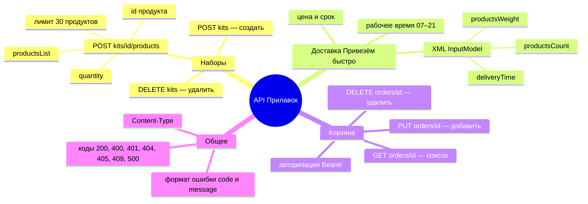

# Декомпозиция

## Что проверяется в каждом запросе
1. **Метод и путь:** допустимый метод, существующий путь, наличие идентификатора.
2. **Заголовки:** Content-Type, Authorization.
3. **Тело:** формат (JSON или XML), обязательные поля, типы, диапазоны.
4. **Ответ:** код, тело, формат ошибки, отсутствие технических деталей.
5. **Состояние:** изменение данных (набор, корзина) корректно записано.
