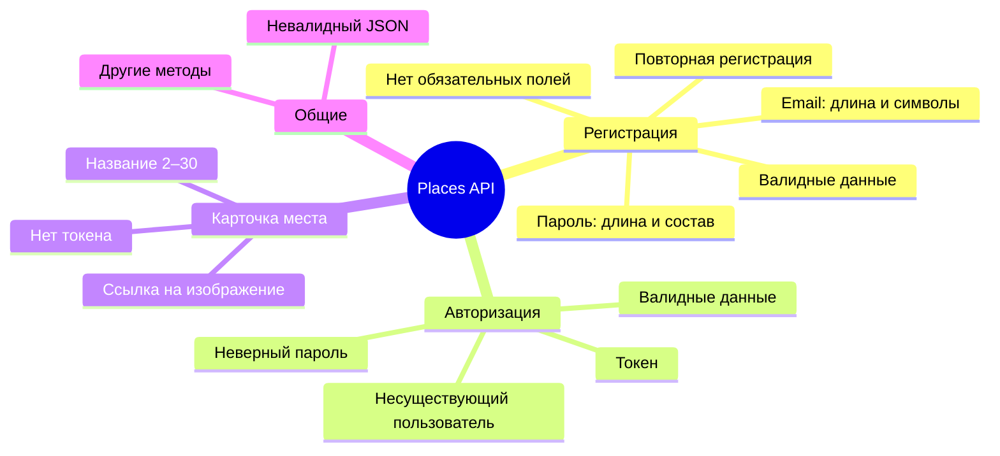

# Разбор API: Places

Дополнительный разбор к спринту 5: полный цикл тест-дизайна для API из трёх методов (регистрация, вход, добавление карточки места). Здесь отработаны стратегия, декомпозиция, техники и чек-лист. Данные: [`data/api-places.json`](../data/api-places.json), коллекция Postman: [`postman/places-api.postman_collection.json`](../postman/places-api.postman_collection.json), интерактивная версия: [Разбор API](https://ikqavscode-afk.github.io/Sprint_5/places.html).

## Контракт

| Метод | Путь | Авторизация | Успех | Ошибки |
|---|---|---|---|---|
| POST | `/api/signup` | нет | 201 | 400 Не передан обязательный параметр; 400 Почта введена некорректно; 400 Пароль введен некорректно; 409 Пользователь с таким email уже существует; 500 Внутренняя ошибка сервера |
| POST | `/api/signin` | нет | 200 | 400 Не передан обязательный параметр; 400 Почта введена некорректно; 401 Неправильные почта или пароль; 404 Пользователь не найден |
| POST | `/api/cards` | токен | 201 | 400 Отсутствует наименование; 400 Отсутствует ссылка на изображение; 400 Наименование введено некорректно; 400 Ссылка введена некорректно; 401 Требуется авторизация |

## Стратегия тестирования

| Объект | Что проверяем | Техника |
|---|---|---|
| Регистрация пользователя | Комбинации email и пароля: пустые поля, формат, длина, допустимые символы, валидные данные | Классы эквивалентности, граничные значения, негативные сценарии |
| Авторизация пользователя | Вход с корректными и некорректными данными, пустыми полями, несуществующим пользователем | Таблица принятия решений, классы эквивалентности |
| Обработка токена | Отсутствие токена, недействительный токен, успешная авторизация | Позитивные и негативные сценарии |
| Добавление карточки места | Поля name и link: пустые, короткие, длинные, неверный URL, корректные значения | Классы эквивалентности, граничные значения |
| Ответы сервера | Структура и типы полей успешного ответа, коды состояния | Позитивные и негативные сценарии |
| Обработка ошибок | Сообщения при валидации, отсутствии параметров, неверных данных, неавторизованном доступе | Таблица принятия решений, негативные сценарии |

## Декомпозиция

## Классы эквивалентности и границы

| Поле | Границы (вся строка) | Классы |
|---|---|---|
| email | 4 · **5** · 6 … 49 · **50** · 51 | пусто; валидный; недопустимые символы; нет поля |
| password | 7 · **8** · 9 … 19 · **20** · 21 | пусто; без заглавной; без строчной; без цифры; без спецсимвола; кириллица |
| name | 1 · **2** · 3 … 29 · **30** · 31 | пусто; валидное; нет поля |
| link | n/a | валидный URL; пусто; не URL; нет поля |

## Таблица принятия решений: вход

### Вариант A: любая ошибка данных даёт 401

| Email валиден | Пароль валиден | Пользователь существует | Код | Результат |
|---|---|---|---|---|
| Да | Да | Да | 200 | Успешная авторизация, token |
| Да | Да | Нет | 404 | Пользователь не найден |
| Да | Нет | Да | 401 | Неправильные почта или пароль |
| Да | Нет | Нет | 401 | Неправильные почта или пароль |
| Нет | Да | Да | 401 | Неправильные почта или пароль |
| Нет | Да | Нет | 401 | Неправильные почта или пароль |
| Нет | Нет | Да | 401 | Неправильные почта или пароль |
| Нет | Нет | Нет | 401 | Неправильные почта или пароль |

### Вариант B: формат email проверяется отдельно (по документации)

| Email валиден | Пароль валиден | Пользователь существует | Код | Результат |
|---|---|---|---|---|
| Да | Да | Да | 200 | Успешная авторизация, token |
| Да | Нет | Да | 401 | Неправильные почта или пароль |
| Нет | Да | Да | 400 | Почта введена некорректно |
| Нет | Нет | Да | 401 | Неправильные почта или пароль |
| Да | Да | Нет | 404 | Пользователь не найден |
| Нет | Да | Нет | 404 | Пользователь не найден |
| Нет | Нет | Нет | 404 | Пользователь не найден |

Расхождения: некорректный email у существующего пользователя (401 или 400) и сочетания с несуществующим пользователем (401 или 404).

## Серые зоны

| ID | Тема | Проблема | Вопрос | Допущение |
|---|---|---|---|---|
| GZ-P1 | Длина email | В документации длина считается для всей строки (5–50). В примерах из материалов считалась длина части до «@». | Что именно ограничено: вся строка или часть до «@»? | Принято: вся строка. Границы строятся по общей длине. |
| GZ-P2 | Пустое значение или отсутствие поля | Сообщение для пустой строки в email, password, name не определено: «Не передан обязательный параметр» или «…некорректно». | Одинаково ли обрабатываются пустая строка и отсутствие поля? | Проверяется только код ответа (400). |
| GZ-P3 | Вход: некорректный формат email | Документация даёт 400 «Почта введена некорректно», а в одном из вариантов таблицы принят 401. | Проверяется ли формат email при входе? | Принято по документации: 400. |
| GZ-P4 | Вход: несуществующий пользователь | Один вариант таблицы даёт 404 для любых данных, другой смешивает 401 и 404. | Какой код при несуществующем пользователе и неверном пароле? | Принято: 404 для корректных данных. |
| GZ-P5 | Допустимые спецсимволы пароля | Дан пример «!@#$%^&*()», полный список не определён; кириллица не описана. | Какие символы допустимы? | Кириллица считается недопустимой. |
| GZ-P6 | Пробелы в названии места | Пробел до или после названия: обрезается ли, входит ли в длину? | Применяется ли trim? | Проверка не включена в чек-лист. |
| GZ-P7 | Формат ссылки | Не определены допустимые схемы (http, ftp), проверка доступности изображения. | Что считается валидным URL? | Проверяется формат «https://…». |
| GZ-P8 | Токен | Не указаны срок жизни и формат заголовка (с префиксом Bearer или без). | Как передавать токен? | Заголовок Authorization со значением токена. |
| GZ-P9 | Ошибка 500 при регистрации | Внутренняя ошибка описана в документации, условия её воспроизведения не указаны. | Когда возвращается 500? | Не проверяется. |
| GZ-P10 | Регистр email | Считаются ли «A@example.com» и «a@example.com» одним пользователем? | Нужна ли нормализация? | Не проверяется. |
| GZ-P11 | Создание записи в БД | Проверить сохранение пользователя в базе нельзя: нет доступа к БД и нет метода чтения. | Есть ли метод получения пользователя? | Пропущено (Skipped). |
